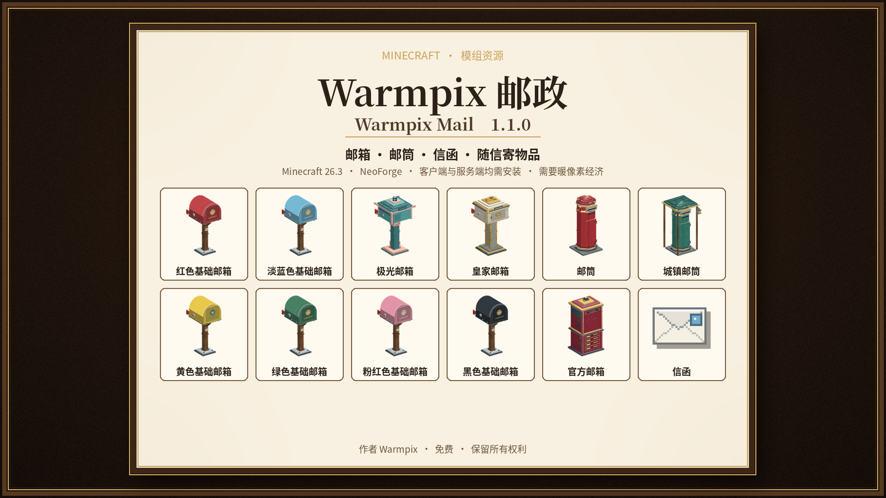
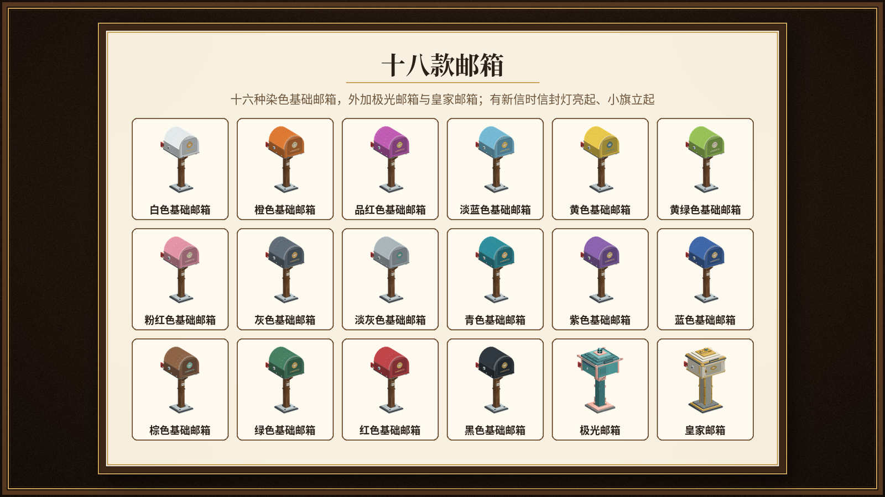
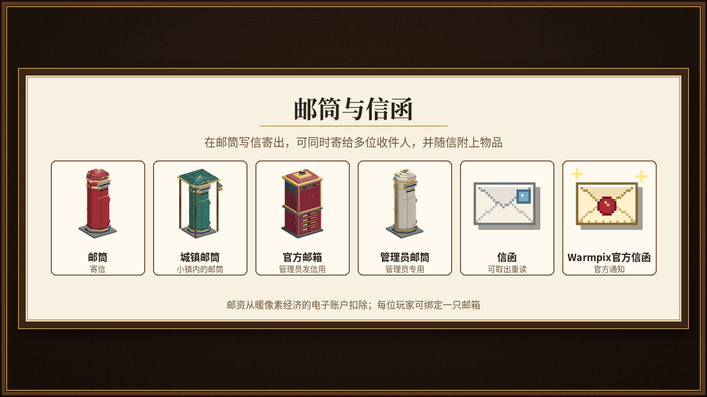
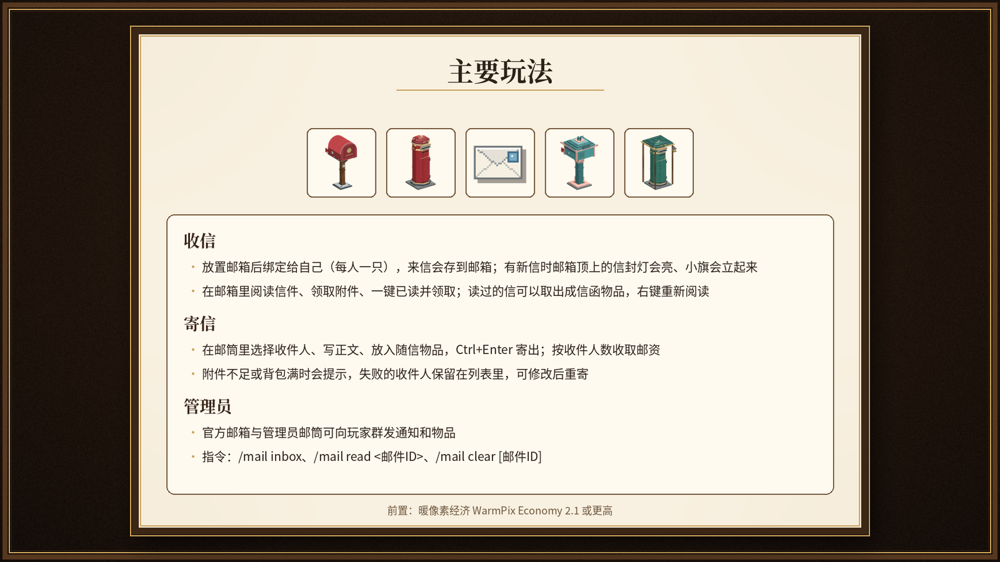

# Warmpix 邮政 Warmpix Mail

在游戏里写信寄信：18 款邮箱、邮筒、信函，可随信附上物品，有新信时邮箱亮灯立旗。

- Minecraft：26.3
- 加载器：NeoForge 26.3.0.23-beta 或更高
- 客户端与服务端都需要安装
- 前置：暖像素经济 WarmPix Economy 2.1 或更高（邮资从电子账户扣除）
- 语言：简体中文 / English

## 截图 Screenshots

## 下载

请到 [Releases](../../releases) 页面下载 jar（版本 1.1.0）。

## 内容

- 16 种染色基础邮箱，外加极光邮箱、皇家邮箱；放置后绑定给自己（每人一只）
- 有新信时邮箱顶上的信封灯会亮起、小旗立起；聊天里也会提示未读来信
- 在邮筒里选择收件人、写正文、放入随信物品后寄出，可一次寄给多位收件人，按人数收取邮资
- 邮箱内阅读、领取附件、一键全部已读并领取；读过的信可取出成信函物品，右键重读
- 城镇邮筒（需位于小镇内）、官方邮箱与管理员邮筒，管理员可群发通知与物品
- 指令：/mail inbox、/mail read <邮件ID>、/mail clear [邮件ID]
- 16 种基础邮箱和邮筒可以合成；极光、皇家、官方邮箱与城镇、管理员邮筒没有配方

## 说明

- 本仓库只用于发布 jar，不含源码。
- 必须同时安装暖像素经济（WarmPix Economy）。

作者：Warmpix ｜ 许可：All Rights Reserved（保留所有权利）

## 🏡 暖像素 WarmPix 服务器

本模组正在 **暖像素 WarmPix** 服务器上使用，欢迎来服里实际体验。

暖像素 WarmPix 是新开的 Java 26.3 NeoForge 模组生存服，公益服无付费内容，多线、无白名单，正版/离线账号都能进。新服招人开荒，长期稳定运营、永久不跑路。

- 服务器地址：`minecraft.warmpix.com`
- 官网：https://warmpix.com/
- 宣传片：https://www.bilibili.com/video/BV1NhWh6dEcu/
- QQ 群：**705556278**

扫码或搜索群号 705556278 加入 QQ 群。
